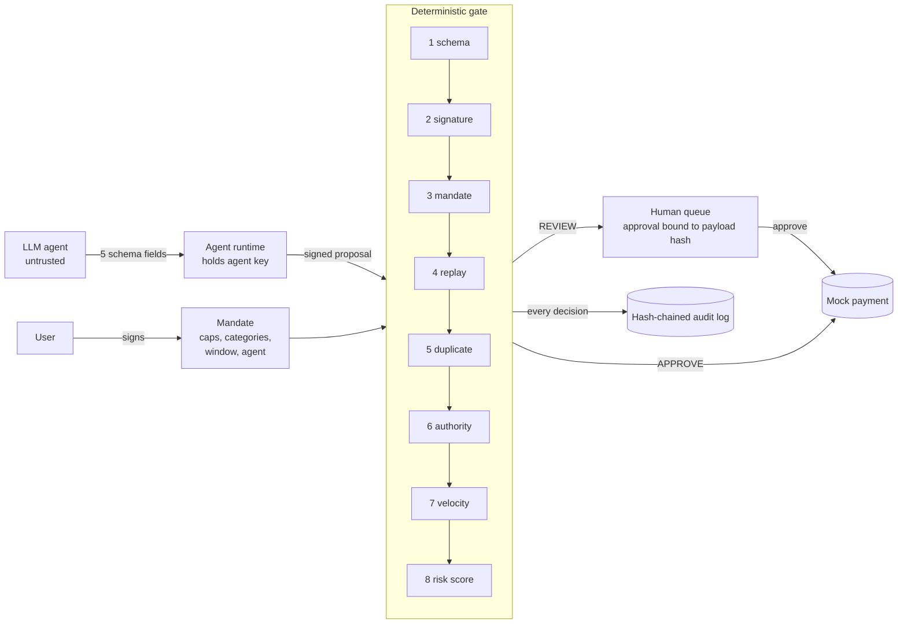

# Mandate Gate

**A deterministic authorization layer for AI shopping agents.**

An AI agent can *propose* a purchase. It can never *make* one. Every proposal passes through plain, ordered, testable code that
checks a signature, the user's signed spending mandate, replay and duplicate protection, spending caps and a velocity limit. Only
then does a small advisory risk score get a say, and it can only make the outcome **stricter**. Every decision, denials included,
is written to a hash-chained audit log *before* any money moves.

The code is the gate and the attack suite. The fraud model is deliberately small.

> **Everything here is a simulation:** no real money, identity, merchants or payment rails, and the risk model is trained on
> synthetic data. [What is real and what is simulated](#what-is-real-and-what-is-simulated) is the most important section.
> [AI_ASSISTANCE_LOG.md](AI_ASSISTANCE_LOG.md) says plainly how this repository was built.

## Relationship to existing work

This follows a pattern the Agent Trust team already works with: signed identity, deterministic checks, risk as advisory input. That
is deliberate; the aim was to build on a known pattern rather than invent a different one. What this repository adds to that pattern:

- a risk score that **can only tighten** a decision and explains itself with reason codes;
- **idempotency keys on top of nonces**, so a replayed message and a legitimate retry are different cases;
- **cumulative caps and a velocity limit**, with pending human reviews counting against both;
- a **hash-chained audit log** written before any state change;
- an **adversarial test suite** (40 named attacks) and a **mutation check** that proves each gate check is load-bearing.

## How it works



Checks run in a fixed order and stop at the first failure. Any exception is a denial (fail closed). The agent never sees thresholds.

| # | Check | Stops |
|---|---|---|
| 1 | schema | Malformed input, extra fields, floats, look-alike text |
| 2 | signature | Forged or edited proposals; the wrong key for the role |
| 3 | mandate | No, expired, altered, foreign or revoked consent |
| 4 | replay | A captured message resent (nonce plus time window) |
| 5 | duplicate | A retry charging twice; a reused key smuggling in a different purchase |
| 6 | authority | Per-purchase and cumulative caps, categories, currency |
| 7 | velocity | One big purchase split into many small ones; queues of pending reviews |
| 8 | risk | In-mandate spend that looks wrong. Can only tighten: approve, review or deny |

Two properties matter most. **The risk score can only make a decision stricter**, so a low score never overrides a failed check. **A
human approval is tied to the exact proposal it was given for**, so it cannot be reused for a retry or an altered amount.

The order is a security property, not a style choice. [docs/MUTATION_REPORT.md](docs/MUTATION_REPORT.md) *measures* what breaks when each is removed;
[docs/GATE_WALKTHROUGH.md](docs/GATE_WALKTHROUGH.md) reads `gate.py` top to bottom with the reasoning.

### How it maps to Agent Trust

| Trust element | What Mandate Gate does | Module |
|---|---|---|
| Identity | Each agent holds an Ed25519 key; every proposal is signed and checked against a key registry | `signing.py`, `registry.py` |
| Consent | The user signs a mandate with limits, categories and an expiry; a missing, expired or altered mandate means deny | `mandate.py` |
| Delegated authority | Per-transaction and cumulative caps, allowed categories, replay and duplicate protection, velocity | `gate.py` |
| Transaction risk | A small model returns a fraud score and the top reason codes; fixed thresholds route to approve, review or deny | `risk/` |

## Quickstart

Python 3.10+. The gate, tests and rules-only demo need only `cryptography`; the risk model needs the `ml` extra.

```bash
python -m venv .venv && source .venv/bin/activate
pip install -e ".[ml,dev]"

python -m unittest discover -s tests -t . -v     # 189 tests (pytest also works: python -m pytest)
python -m mandate_gate demo                      # end-to-end demo, offline; exits 1 on any deviation
python -m mandate_gate demo --no-model           # rules only, no ML dependencies
python -m mandate_gate demo --interactive        # you approve or reject queued reviews at the prompt
python -m mandate_gate verify-log demo_out/audit.jsonl
python scripts/mutation_check.py --report docs/MUTATION_REPORT.md   # disable each check; each must fail a test
python examples/quickstart.py                    # the gate used as a library
python -m mandate_gate evaluate-risk             # regenerate the model, frozen thresholds, metrics (~10 s, deterministic)
python scripts/build_notebook.py                 # rebuild notebooks/risk_model.ipynb
```

Without installing, prefix commands with `PYTHONPATH=src`. A recorded demo run is in [docs/demo_transcript.txt](docs/demo_transcript.txt).

### What the demo shows

A scripted agent runs through eleven scenarios, each with an expected outcome the demo checks: a routine purchase; a retry (no second
charge); a replayed message; an amount edited after signing; an over-cap purchase; a disallowed category; **prompt injection** (a
deliberately gullible agent obeys text on a merchant page: an injected gift-card purchase is denied by the mandate, extra injected
fields are rejected by the schema, and an injected purchase that stays *inside* the mandate is caught only by the risk score, and
goes through in `--no-model` mode); a split purchase stopped by the velocity limit; large night-time purchases at new merchants sent
to a human; an approval and a rejection; and an approval that cannot be reused or carried over to a different amount or merchant.
It finishes by verifying the audit chain and showing that editing one record is detected.

### Use it as a library

```python
from mandate_gate.gate import Gate, GateConfig
from mandate_gate.audit import AuditLog
from mandate_gate.registry import KeyRegistry

# 1. register the agent's and the user's public keys (kinds "agent" and "user")
# 2. the user signs a mandate; the agent runtime signs a proposal
gate = Gate(registry, AuditLog("audit.jsonl"), GateConfig())
decision = gate.evaluate(signed_proposal, signed_mandate)   # APPROVE / REVIEW / DENY plus reason codes
# REVIEW: show a human the exact proposal and its payload hash, then
# gate.resolve_review(review_id, approve=True, approver="alice", payload_hash=shown_hash)
```

`examples/quickstart.py` is the maintained, tested version of this snippet; copy from it, not from here.

## Evidence that it holds

| Claim | Evidence |
|---|---|
| Unauthorised spend does not get through | 40 named attack scenarios (`tests/test_attacks.py`, A01-A40) across identity, consent, replay, authority, input and human/model; each asserts that no spend happened without authority |
| Every check is load-bearing | `scripts/mutation_check.py` disables each check (and approval binding, input snapshot, audit log, review reservation, key kind, domain separation, strict keys) and requires a failing test: **15 of 15 killed** |
| Risk cannot loosen a decision | A 400-case randomised differential test plus `A39`; the scorer can only return review, deny or no objection |
| The log shows tampering | Edit, delete, reorder and insert are all detected (`AuditChain` tests); the demo edits a copy and verifies it fails |
| The demo is checked, not just shown | It carries expected outcomes and exits 1 on any deviation |

## Risk model (small on purpose)

The model is advisory, and the gate is safe whether it is good, bad or missing, so it is kept small enough to explain in one breath: a
**logistic regression** over a handful of transforms of nine features. Its reason codes need no approximation: each feature's term is
`weight × (value − training mean) / scale`, and the terms plus the intercept add up to the log-odds exactly. The saved model is plain
JSON, with its SHA-256 pinned in the frozen thresholds file.

Evaluation, on **synthetic** data, time-ordered 60/20/20 split. Thresholds were chosen on validation, **written to disk, and only then
was the test split scored** (a test asserts the order). Test split: 9,631 proposals, 1.4% fraud.

| | PR-AUC | precision | recall |
|---|---:|---:|---:|
| Model at review threshold | 0.777 | 0.602 | 0.752 |
| Model at deny threshold | 0.777 | 0.970 | 0.481 |
| Never-fraud baseline | 0.014 | n/a | 0.000 |

The baseline is 98.6% accurate and catches nothing, which is why accuracy is not the headline.

What the numbers do **not** say:

- Recall at the review threshold was 0.90 on validation and 0.75 on test. The drop is mostly one pattern (`slow_novel`, recall 0.04)
  that appears only late in the timeline and was never in training. That is reported, not tuned away.
- The model partly learns a **shortcut in my simulator** (some categories are rare for legitimate agents), which the reason codes make
  visible. Scores mean nothing outside the simulator.
- An earlier version used gradient boosting with a hand-written TreeSHAP. It scored PR-AUC 0.81 against this model's 0.78, a gap the
  synthetic data cannot meaningfully separate, for far more code to defend, so it was cut. See [DECISIONS.md](DECISIONS.md).

Details: [artifacts/risk/report.md](artifacts/risk/report.md) and [notebooks/risk_model.ipynb](notebooks/risk_model.ipynb).

## What is real and what is simulated

The first eight rows are the table from the project brief, as written. The rows after the divider were added during the build.

| Component | Status | Limit |
|---|---|---|
| Signatures | Real Ed25519 | Signs canonical JSON, not an RFC 9421 HTTP message signature, unless I finish the stretch goal. |
| Agent identity | Simulated | The key registry is a local file. There is no real identity proofing or human-to-agent binding. |
| Payments | Simulated | A charge is a ledger entry. No payment network is touched. |
| Fraud data | Synthetic | I write the fraud patterns myself, so the metrics show that the evaluation method works and say nothing about real-world performance. |
| Risk model | Real model, synthetic data | Scores mean nothing outside the simulator. |
| Shopping agent | Mock by default | The Claude-backed agent is optional and untuned. |
| Audit log | Real hash chain | Single process, with no external anchoring. |
| Human approval | CLI prompt | The approver is not authenticated. |
| *Added during the build* | | |
| Gate state | In memory | Nonces, idempotency keys, ledger and pending reviews are lost on restart; a still-fresh message could be replayed once. |
| Claude-backed agent | Never run | Written but not exercised against the real API; a fake client is tested. |
| Reason codes | Exact | Exact for a linear model, but they explain the model, not the world. |
| Risk model shortcut | Disclosed | It leans on a simulator artefact (rare categories). Reported, not tuned away. |
| `pip install .` | Not verified in the build sandbox | The tests, demo and examples were run from source; CI is expected to verify the install. |
| GitHub Actions workflow | Not run | Written, never executed. |

## What I would do next

1. **Web Bot Auth / RFC 9421 signing.** Swap the canonical-JSON envelope for an HTTP Message Signature so the same Ed25519 key
   identifies the agent to merchants and to the gate. Web Bot Auth identifies the *agent*; the mandate (user-signed spending authority)
   has no equivalent in it and stays as it is. The change is confined to `signing.py`, `envelope.py` and key lookup in `registry.py`;
   the check order, ledger, log and attack suite do not change. See [docs/INTERVIEW_PREP.md](docs/INTERVIEW_PREP.md) section 6 for the
   mapping and sources. Not built here on purpose: it is wire plumbing, not gate logic.
2. **Durable state** with an atomic decide-and-commit, and an external anchor for the audit head hash.
3. **Real identity binding** and an authenticated human approver.
4. **Fraud labels that arrive late, and drift monitoring**, with real data instead of a simulator.
5. Velocity budgets shared across several mandates held by one agent.

Also not built: payment rails, multi-process operation, rate limiting of the gate itself.
[THREAT_MODEL.md](THREAT_MODEL.md) maps 18 threats to a control and a test, and lists the known gaps.

## Repository layout

```
src/mandate_gate/        the gate and its parts: canonical, signing, registry, mandate, proposal, ledger, audit, gate,
                         agent (mock, gullible, Claude-backed), cli, demo
src/mandate_gate/risk/   features, synthetic data, small model, thresholds, evaluation
tests/                   189 tests: unit, 40 named attacks (A01-A40), randomised property tests, risk pipeline
scripts/                 mutation_check.py, build_notebook.py
notebooks/               risk_model.ipynb: precision, recall, PR-AUC against a never-fraud baseline
artifacts/risk/          committed model (JSON), frozen thresholds, metrics, report, PR curve
docs/                    GATE_WALKTHROUGH, MUTATION_REPORT, demo_transcript
THREAT_MODEL.md  DECISIONS.md  AI_ASSISTANCE_LOG.md
```

## Documents

| File | Purpose |
|---|---|
| [THREAT_MODEL.md](THREAT_MODEL.md) | Who is trusted, 18 threats with control and test, known gaps |
| [DECISIONS.md](DECISIONS.md) | Per module: the choice, a rejected alternative, how it fails |
| [AI_ASSISTANCE_LOG.md](AI_ASSISTANCE_LOG.md) | Who wrote what, what was found wrong, what a human must still do |
| [docs/GATE_WALKTHROUGH.md](docs/GATE_WALKTHROUGH.md) | `gate.py` top to bottom, with the reasoning and likely questions |
| [docs/MUTATION_REPORT.md](docs/MUTATION_REPORT.md) | 15 mutants, all killed |

## License

MIT. See [LICENSE](LICENSE).
