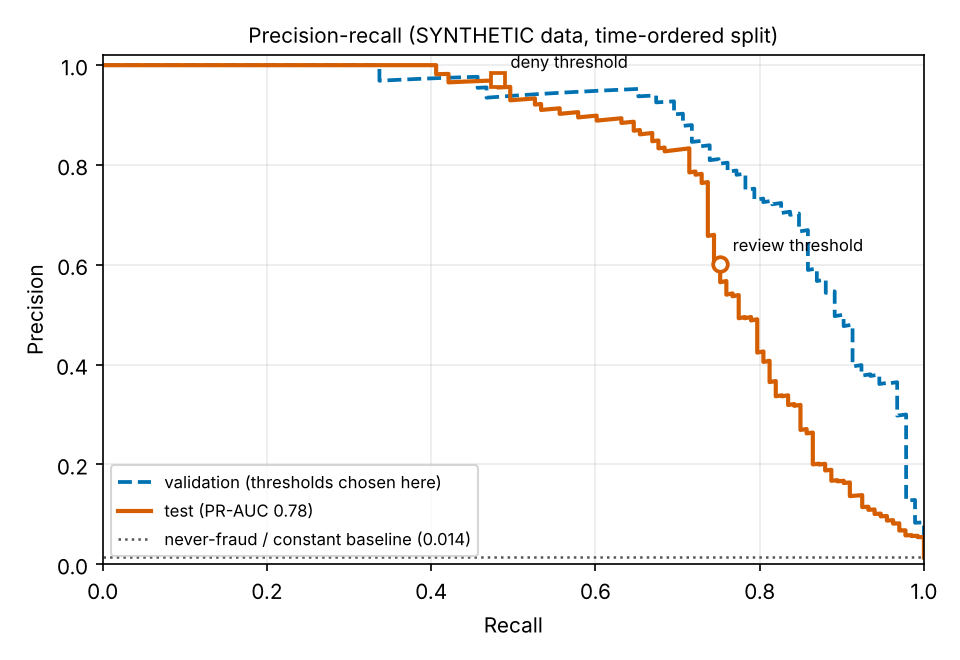

# Risk model evaluation

> **Synthetic data.** The fraud patterns were written by the project author. These numbers show the
> evaluation method works; they say nothing about performance on real fraud.

Model: logistic regression  |  reason codes: `linear`  |  model: `logit-fa93b699fa6e`

## Splits (time-ordered, no shuffling)

| split | rows | fraud | fraud rate |
|---|---:|---:|---:|
| train | 28,892 | 270 | 0.935% |
| validation | 9,631 | 92 | 0.955% |
| test | 9,631 | 133 | 1.381% |

## Thresholds (chosen on validation, frozen before the test split was scored)

- review (send to a human) at score >= **0.03479873285718275**  (target: recall >= 0.9 on validation)
- deny at score >= **0.6876644108892366**  (target: precision >= 0.95 on validation)

Order of events: generate -> time_split -> fit_on_train -> score_validation -> choose_thresholds_on_validation -> thresholds_frozen_to_disk -> score_test

## Test results

| | PR-AUC | precision | recall | accuracy |
|---|---:|---:|---:|---:|
| Model, flag at review threshold | 0.777 | 0.602 | 0.752 | 0.990 |
| Model, flag at deny threshold | 0.777 | 0.970 | 0.481 | |
| Never-fraud baseline | 0.014 | n/a | 0.000 | 0.986 |

Confusion matrix at the review threshold: TP 100, FP 66, FN 33, TN 9432.
Confusion matrix at the deny threshold: TP 64, FP 2, FN 69, TN 9496.

The never-fraud baseline looks excellent on accuracy and catches nothing, which is why accuracy is not reported as a headline.

## Where proposals land on the test split

| route | legitimate | fraud |
|---|---:|---:|
| approve | 9,432 | 33 |
| review | 64 | 36 |
| deny | 2 | 64 |

## Recall by fraud pattern (test, at the review threshold)

| pattern | n | caught | recall |
|---|---:|---:|---:|
| card_testing | 40 | 37 | 0.925 |
| cap_hugging | 28 | 23 | 0.821 |
| drain | 41 | 39 | 0.951 |
| slow_novel  (never seen in training) | 24 | 1 | 0.042 |

